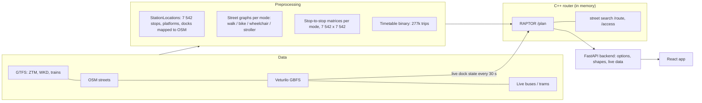

# WarsawOpenData

Route planner for Warsaw that combines public transport with **Veturilo** (city bikes) and the **own bike** at any
stage of a trip, and plans step-free trips for **wheelchair** and **stroller** users. Built in a 24-hour hackathon on
Warsaw open data. Presentation: https://canva.link/vovbml3ezw723k3 (PDF: `ui/concept-art/canva-presentation.pdf`).

> **Status: working.** The whole chain runs on real data: GTFS timetables (ZTM, WKD, trains), OpenStreetMap streets,
> live Veturilo docks and live bus / tram positions. Every transit search is planned by **our own RAPTOR-based router
> in C++**, on street networks and stop-to-stop matrices that are precomputed for each travel mode. The app (React)
> shows the options, the route on a 2D or 3D map, and guides the user during the trip. Tests: 262 frontend and 518
> backend / algorithm tests pass on `main`.

## What the app does

**Planning**
- Start (own location, typed, or picked on the map) and destination; up to 5 intermediate stops, in the given or the
  optimal order. Departure now or at a chosen date and time.
- Up to 6 options per search, sorted by time; per search: sort (fastest, fewest transfers, most active), vehicles,
  max transfers, max walking time; a refresh button.
- Three main modes: **Komunikacja** (public transport), **Pieszo** (walking only), **Rower** (own bike only).
- **Veturilo inside transit trips**: rent a bike at any dock, ride, return it at any dock, and continue by bus, tram,
  metro or train ("190 + Veturilo + 17"). Live dock state: rent only where at least N bikes are available now
  ("Rowery na stacji": any / 1+ / 2+ / 3+ / 5+, default 1+).
- **Own bike with transit** ("Z własnym rowerem"): ride to a stop, take the bike on board, ride between two lines,
  ride to the destination ("Rower + 184 + Rower + R80 + Rower").
- **Accessibility** for transit and walking: Pieszo / Na wózku / Z wózkiem dziecięcym. The wheelchair graph has no
  steps (elevators instead, `ramp:wheelchair` allowed); the stroller graph also allows steps with stroller rails.
  Elevators and steps of a route are drawn on the map.
- Exclude means of transport (bus, tram, metro, rail, Veturilo) for good or for one search; exclude districts or own
  points; walking and cycling pace (levels or km/h); time rules ("on weekday mornings ...").
- **Plan from the vehicle you are in**: the next stops of its trip are the start, at their timetable times.

**Live data and the trip**
- "Which vehicle am I in?": the app matches the last GPS points with live buses and trams (every 5 s until the user
  confirms; the vehicle is moved to the time of each GPS point, because the feed lags ~10-20 s).
- Live delays of the buses and trams in the suggested routes ("+3 min", "punktualnie").
- **Active trip**: progress along the route, next step ("Wysiadasz na: ...", "Przesiadka: ..."), off-route warning,
  waiting for a later departure, change of destination or route on the way (from the confirmed vehicle), the map
  zooms to the current leg.
- Alerts of ZTM lines are tagged on the options ("Zmiana na trasie").

**Map and look**
- Flat vector map (OpenFreeMap / OSM) or a tilted **3D map** with buildings; light / dark mode; "liquid glass" look.
- Map layers: Veturilo docks with the live number of bikes, bus / tram posts, metro and rail; "Stąd" / "Dotąd" from a stop.
- Phone layout with draggable sheets and a collapsible search card; desktop layout with a side panel.

**Privacy-first extras (on the device)**
- Calories of a route (MET tables, the user's weight / height / age if given).
- Own speed history from recorded trips; the average can replace the pace setting.
- Frequent places suggested in the search fields (learned on the device only).
- Opt-in anonymous journey statistics for the city (only start / destination anchors and daily counts, off by default).

**City tools (API + reports)**
- Veturilo station siting: best hexagons for new docks (`GET /api/veturilo/siting`, report in
  `artifacts/veturilo-siting/`). Its traffic and e-scooter inputs are **mock data** for now.

## How the routing works



### Preprocessing (built once, checked by hash)

1. **StationLocations** (`backend/stations.py`, `algorithms/station_map.py`): one list of transport nodes shared by
   the router, the backend and the app: 6 244 bus posts, 610 tram posts, 39 metro platforms, 207 rail platforms,
   93 rail stations, 349 Veturilo docks. GTFS decides what exists; an exact OpenStreetMap match moves the point to the
   real post / platform (post `ref` = ZTM id within 50 m: ~90%; metro platforms join through their entrances). GTFS feeds
   are merged without duplicates (SKM from the train feed, rail stations merged only rail-to-rail).
2. **Street graphs** (`backend/sources/osm.py`, `algorithms/street_model.py`): 1.86 M nodes, ~4.1-4.2 M edges per mode.
   Cost = length / speed + the expected wait at crossings (signal waits from the HCM formula, signal nodes within 30 m
   paid once as one junction) + 60 s per elevator. Modes: walk; bike (ride, push where riding is not allowed);
   wheelchair (no steps); stroller (steps only with rails). Points join the graph through up to 6 nearest nodes.
3. **Stop-to-stop matrices** (`backend/preprocess_street.py` → C++ `street_router matrix`): for every pair of the
   7 542 nodes and every mode, the walked metres, ridden metres and waiting seconds of the shortest street path
   (float32, 683 MB per mode, memory-mapped). Because time is re-computed from metres per query, the user's own pace
   is applied without recomputing anything. A hash of the nodes and the model guards against stale matrices.
4. **Timetable** (`backend/preprocess_transit.py`, `algorithms/timetable_file.py`): all trips as calls at the node
   indexes (277 636 trips, 7.7 M calls, 364 days); metro frequency runs expanded to single trips.

### RAPTOR, adapted (`algorithms/router/raptor.hpp`, `transit.hpp`, design: `docs/raptor-graph.md`)

- **Rounds = counted legs.** A ride or a Veturilo rental counts as a leg; walking and the own bike do not. The answer
  is the Pareto set of (legs, arrival): an option with more legs is kept only if it arrives earlier.
- **Route patterns per service day** (built on first use, cached): trips grouped by line and exact stop sequence,
  split so that no trip overtakes another (FIFO), so the next departure is a binary search. Trips of the previous day
  that run after midnight are included.
- **Footpaths from the matrices** of the query's mode, with no distance cut: any stop can be reached on foot (or by
  own bike, or by wheelchair) from any other, timed at the user's pace.
- **Veturilo as a leg**: dock → dock with 30 s for the rental and 15 s for the return, timed at the user's cycling
  pace; only docks with at least `min_bikes` bikes in the live state (pushed every 30 s, frozen for one query so
  RAPTOR's "earlier is never worse" holds).
- **Access and egress**: one street search from the start to all nodes and one reversed search to the destination.
- **Options**: excluded modes, max legs (= max transfers + 1), limits for access / egress / footpaths / Veturilo.
- Speed on real data: ~0.7 s per query with no limits (most of it the two whole-city street searches).
- The backend (`backend/app/routing/real_engine.py`) turns the router's ids into options: GTFS shapes cut at the real
  stop positions, street paths with elevators and steps, titles ("16 + M1"), a second query 60 s later for more
  departures, duplicates removed, a walk-only option when transit cannot help, live delays and alerts added for display.
  **The router plans on the timetable only**: live delays are shown, not used for planning.
- **From the vehicle** (`backend/app/routing/onboard.py`): the live feed identifies the trip; its next 2 stops at their
  scheduled times are the start points; the ride to them is prepended.

### Evidence

- Bus / tram detection: simulations on recorded live traffic (`algorithms/simulation/RESULTS.md`,
  `artifacts/bus-detection/`): the own vehicle is among the 4 offered in 100% of cases and first in 96-100% with 3 GPS
  points; crowded places are the hard case (78-94% first with 3 points, always offered).
- Delay estimate: 80 m radius chosen by a search on a 32-minute recording, delay shown for 96.5% of stop passes within
  30 s of the reference (`artifacts/delays/`).
- RAPTOR is tested against a brute force on random timetables (`algorithms/test_raptor.py`).

## Known limitations

- Live delays and vehicle positions are not used for planning (timetable only, by decision); the delay is shown.
- Free places at the Veturilo return dock are not checked; Veturilo is offered only in the walking mode (not with
  the own bike, wheelchair or stroller).
- GTFS pickup / drop-off rules and the trips' `wheelchair_accessible` flag are not used yet; stops are step-free,
  vehicles are not checked. Metro: an elevator is assumed at every entrance.
- Street model: average signal waits (no timing data), no kerbs, surface or slope.
- Excluded areas remove options after planning (the search does not route around them).
- The matrices must be rebuilt by hand after a change of the stops, OSM or the street model.
- Live vehicle data needs `PORTAL_KEY` and a server that can reach the City Hall API from Poland.
- The 3D map is a prototype (no picking on the map, no stop markers of the route).
- Issues #63-#66 were opened for the old Python planner (now removed) and still need a re-check on RAPTOR;
  open: #124 (router crash under concurrent requests), #129 (two bike legs in a row), #95 (dock availability ideas).

## Tech stack

- Frontend: React 18 + TypeScript + Vite 5, Material UI 6, Leaflet + MapLibre GL (OpenFreeMap tiles), 3D map in MapLibre
- Backend: Python 3.12 + FastAPI, managed with uv; SQLite for the opt-in journey counters
- Router: C++23 (`algorithms/router/`, cpp-httplib, nlohmann/json): street search + RAPTOR, started by the backend
- Data: raw files in `data/` (GTFS and the OSM cut in Git LFS), caches in `data/derived/`

## Folder structure

- `frontend/` — React app
- `backend/` — FastAPI app, data download and parsers (see `backend/README.md`)
- `algorithms/` — pure algorithm functions with their tests, the C++ router (`algorithms/router/`, see its README) and
  the simulation scripts (`algorithms/simulation/`)
- `data/` — datasets, the API reference `data/API.md` (the contract) and the data report `data/REPORT.md`
- `docs/` — design of the RAPTOR graph (`docs/raptor-graph.md`)
- `integration/` — integration tests in simulation mode (see `integration/README.md`)
- `deploy/` — reproducible server setup (`setup.sh`, `run.sh`, `nginx.sh`)
- `artifacts/` — HTML pages with results (detection, delays, siting, frequent places)
- `ui/` — concept art and the presentation; `changes/` — one change note per branch; `db/` — SQLite file (git-ignored)

## Quick start

Full steps are in "Environment setup (for agents)" below. In short:

```bash
cd frontend && npm install && npm run dev                      # http://localhost:5173
cd backend && uv sync && uv run uvicorn main:app --reload      # http://localhost:8000/docs
# once: build the C++ router and the matrices (see step 4 below)
```

## Data

- GTFS from [mkuran.pl](https://mkuran.pl/gtfs/) — ZTM (bus, tram, metro), WKD and trains incl. SKM
- [Warsaw City Hall APIs](https://api.um.warszawa.pl/) — live bus and tram positions (`PORTAL_KEY`, see `ACCESS.md`)
- Veturilo stations and live dock state (Nextbike GBFS)
- OpenStreetMap (Geofabrik `mazowieckie`, cut to the ZTM area); ZTM alerts from mkuran.pl

Details, ID links and graph sizes: `data/REPORT.md`.

## Deploy on a server (reproducible)

On a fresh Ubuntu 24.04 machine, as root, with git access to this repo:

```sh
git clone git@github.com:szymon-hajderek/WarsawOpenData.git /root/WarsawOpenData
cp <your .env with PORTAL_KEY etc.> /root/WarsawOpenData/.env     # live vehicles / delays
bash /root/WarsawOpenData/deploy/setup.sh      # toolchain (g++-14, node 20, git-lfs, uv), builds, all data (~20-30 min)
bash /root/WarsawOpenData/deploy/run.sh        # backend + router on 127.0.0.1:8000, the app on 0.0.0.0:8080
```

Public HTTPS (needed for geolocation): with a domain pointing at the server and ports 80 + 443 open,
`bash deploy/nginx.sh app.example.pl` puts nginx with a Let's Encrypt certificate in front of port 8080. Without open
ports (e.g. a RunPod pod) a Cloudflare tunnel works: `cloudflared tunnel --url http://localhost:8080`.
`deploy/run.sh stop` stops the app; logs are in `logs/`. Run `setup.sh` again after pulling new code. Keep the repo on
the local disk (data and matrices need ~5 GB and are memory-mapped). Live vehicle data needs a server that can reach the
City Hall API (it does not answer servers outside Poland).

## Environment setup (for agents)

Follow these steps to get a working environment. Run them from the repo root.
Keep this section current: every PR that adds a dependency or a tool updates it.

1. **Keys.** Copy `.env.example` to `.env` and fill in the keys. See `ACCESS.md`. Never commit `.env`.
2. **Frontend** (`frontend/`). Needs Node 18.18 or newer (Vite 5). On Node 26 `npm test` needs
   `NODE_OPTIONS=--no-experimental-webstorage npm test` (otherwise jsdom's `localStorage` is undefined).
   - `cd frontend && npm install` (if `~/.npm` is root-owned: `npm install --cache <some dir>`)
   - `npm run dev` starts the app at http://localhost:5173
   - On a phone (same Wi-Fi) the location button needs HTTPS: stop the other dev server and run `npm run dev:https`,
     then open `https://<laptop-ip>:5173` and accept the self-signed certificate warning once. In the dev server the app
     calls the API on the page's own origin and Vite proxies `/api` to the backend on port 8000, so it works from
     localhost, the laptop's IP and the phone alike (no `VITE_API_URL` needed).
   - `npm run build` type-checks and builds
   - `npm run lint` runs ESLint (react-hooks + jsx-a11y rules); `npm test` runs the Vitest tests (jsdom, no browser needed)
   - optional: `VITE_API_URL` in `frontend/.env` points the app at the routing API
     (default: the page's own origin in the dev server, `http://localhost:8000` in a build; `VITE_API_URL=""` switches the backend off; then, as with a backend URL that does not answer, the app says "Nie połączono z serwerem"; there is no example data)
3. **Data** (`data/`). GTFS zips and the OSM extract are stored with Git LFS.
   - install Git LFS once (`brew install git-lfs` or your package manager), then `git lfs install` and `git lfs pull`
   - or download fresh copies: `cd backend && uv run python download.py` (the OSM step fetches Geofabrik
     `mazowieckie` (300 MB) and keeps a 31 MB cut, `data/osm/warsaw_ztm.osm.pbf`)
4. **Backend** (`backend/`, Python + FastAPI, managed with [uv](https://docs.astral.sh/uv/)).
   - install uv: `brew install uv` (or `curl -LsSf https://astral.sh/uv/install.sh | sh`)
   - `cd backend && uv sync` installs Python 3.12 and all dependencies (`osmium`, `scipy`, `fastapi`, `tzdata`, `gtfs-realtime-bindings` ...)
   - run every backend command from `backend/`
   - `uv run uvicorn main:app --reload` starts the API at http://localhost:8000 (docs at `/docs`).
     This one process serves the data, geocode and `POST /api/routes` (real GTFS + OSM + Veturilo).
   - `uv run python report.py` rebuilds `data/REPORT.md` (sources, ID links, graph sizes, endpoints)
   - the server builds the GTFS / OSM caches in `data/derived/` at start (~25 s / ~17 s on the first run, a minute or two
     with a ready cache). Until then `/api/gtfs`, `/api/osm` and `/api/routes` answer 503 (`Retry-After: 30`)
   - GTFS caches carry a format version (`mkuran.CACHE_VERSION`) in `gtfs_stop_times.npz`; an old cache rebuilds
     automatically from the existing ZIPs. The OSM cache `osm_graph.npz` rebuilds when the `.pbf` is newer.
   - **street router (C++)**: needs CMake 3.20+ and a C++23 compiler (GCC 14+ or Clang 19+); the first configure
     downloads cpp-httplib and nlohmann/json. Build once:
     `cmake -S ../algorithms/router -B ../algorithms/router/build -DCMAKE_BUILD_TYPE=Release &&
     cmake --build ../algorithms/router/build`. The backend then starts it by itself (port 8090) and first rebuilds what is stale:
     `stations.json`, the street graphs `data/derived/street/graph_*.bin` (~30 s) and the RAPTOR timetable `timetable.bin`
     (~10 s; by hand: `uv run python preprocess_transit.py`). Log: `data/derived/street/router.log`. Without it,
     walk / bike legs and `/api/stations/health` answer 503. Optional `.env`: `ROUTER_URL` (use a router that runs elsewhere), `ROUTER_PORT`.
   - the first start also builds `data/derived/stations.json` (transport nodes mapped to OSM, a few seconds;
     `uv run python stations.py` rebuilds it and prints the match report)
   - street matrices for every pair of stops (needed by the router's RAPTOR `POST /plan`; without them `/plan` answers
     503 and `/health` → `plan` says why): `uv run python preprocess_street.py` (four modes, 5-7 min each on 12-16 threads,
     4 x 683 MB). They are **not** rebuilt automatically: run it again after a change of the stops, OSM or the street model. Details: `algorithms/router/README.md`, design: `docs/raptor-graph.md`
   - `uv run pytest tests ../algorithms` runs the tests (pytest is in the `dev` group, installed by `uv sync`)
   - `uv run pytest ../integration` runs the integration tests: synthetic trips on real data in simulation mode,
     about 6 minutes, no keys needed (`-m recorded` / `-m gtfs` for one kind). Results: `integration/RESULTS.md`.
     See `integration/README.md`
   - optional `SIM_SCENARIO=<name>` starts the server in simulation mode with `integration/scenarios/<name>.json`
     (simulated clock, replayed feeds, `/api/sim/*` endpoints, no `PORTAL_KEY` needed)
   - ride demo: `./demo.sh [scenario]` from the repo root starts the backend in simulation mode and the frontend
     (needs `npm install` and `uv sync` once); open http://localhost:5173 and use the "Demo" tab (it exists only in
     simulation mode). `API_PORT` changes the backend port
   - optional `ROUTE_ENGINE` picks the route engine: `real` (default, the only one today)
   - opt-in journey statistics: no extra dependency or database server is needed. Startup creates
     `db/journey_stats.sqlite` (git-ignored; SQLite from the Python standard library). The backend needs write
     access to `db/`. Optional `JOURNEY_STATS_DB` changes the file path; its parent is created automatically.
     Anchors load from local GTFS and `data/gbfs/veturilo_station_information.json`. To download the latter:
     `uv run python download.py nextbike`. Statistics return 503 if no anchor catalog or database is available.
     Enable **Statystyki podróży** in the app's Preferences (off by default), then explicitly start and finish
     a real GPS recording. `POST /api/journeys` stores exact selected object references and daily counts;
     current-location endpoints are replaced by the nearest transit/Veturilo anchor. No full GPS track,
     user/device identifier or precise journey timestamp is kept in this database. See `data/API.md`.
   - bus detection simulation: `uv run python ../algorithms/simulation/simulate_nearest_buses.py`
     (uses the committed sample; record a new one with `uv run python ../algorithms/simulation/record_buses.py`, needs `PORTAL_KEY`)
   - bus + tram recording for the hard cases: `uv run python ../algorithms/simulation/record_buses.py --trams` (writes `data/live/vehicle_track_sample.json`, needs `PORTAL_KEY`)
   - rebuild the result pages in `artifacts/bus-detection/` (simulation, fraction, hotspots): `uv run python ../algorithms/simulation/export_viz.py` (the hotspots page needs the GTFS caches)
   - optional `.env` setting `LIVE_BUSES_URL`: where bus detection reads live bus positions (default: the City Hall feed via `PORTAL_KEY`). Without `PORTAL_KEY` the live-vehicle poller stays off and `GET /api/live/vehicles` returns 503.
   - Veturilo station siting (`GET /api/veturilo/siting`): the server builds the hex grid at start (first run ~2.5 min:
     one extra OSM pass, cached in `data/derived/siting_*.npz`). Trial report + map page:
     `uv run python siting_report.py` (writes `data/SITING_REPORT.md`, `data/siting_report.json`, `artifacts/veturilo-siting/veturilo-siting.html`;
     `--rebuild` recomputes the grid, `--mocks` regenerates the mock data in `data/mock/`). The Warsaw boundary
     `data/geojson/warsaw.geojson` is committed; `uv run python download.py siting` fetches it again from Nominatim
   - optional `.env` setting `DELAY_RADIUS_M`: radius for the delay estimate `GET /api/live/delay` (default `80`, picked by `search_delay_radius.py`)
   - delay simulation on the committed recording `data/live/delay_sample.json.gz`: `uv run python ../algorithms/simulation/simulate_delay.py --radius 30`;
     rebuild the report `artifacts/delays/delay-statistics.html`: `uv run python ../algorithms/simulation/export_delay_viz.py`;
     search the best radius (20-200 m every 10 m, then every 1 m): `uv run python ../algorithms/simulation/search_delay_radius.py`;
     record a new sample (server running, 30 min): `uv run python ../algorithms/simulation/record_delay_sample.py 30`
   - tune that radius on live data (needs `PORTAL_KEY`): `uv run python ../algorithms/simulation/tune_delay_radius.py 8`
5. **Routes** are part of the uv app in step 4. Do not start a second server on port 8000.
   The package `backend/app/` is the route engine imported by `main.py`. `requirements.txt` is only
   the old slim app and cannot load the timetable (it has no numpy/scipy).
6. **Database, Docker.** SQLite journey counters are initialized automatically (step 4).
   PostgreSQL + PostGIS and Docker are not set up yet.
