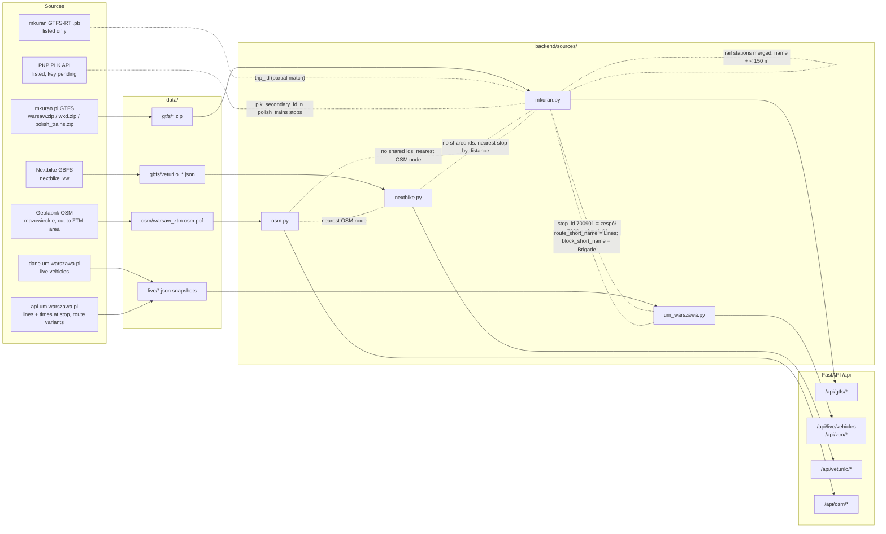

# Data report

Generated 2026-10-17T22:33:07 by `backend/report.py`. Reference day for timetables: 20261021.
Numbers come from the files in `data/`. Re-run the script after a new download.

## Where the data comes from

Solid arrows: data flow. Dotted lines: how IDs connect between sources.

| Source | Status | Key | Content |
|---|---|---|---|
| https://mkuran.pl/gtfs/warsaw.zip | downloaded | - | GTFS: ZTM bus, tram, metro, SKM stops (posts) + timetables + shapes |
| https://mkuran.pl/gtfs/wkd.zip | downloaded | - | GTFS: WKD stations + timetables |
| https://mkuran.pl/gtfs/polish_trains.zip | downloaded | - | GTFS: KM, PKP Intercity, PolRegio ... (SKM dropped, stops filtered to the ZTM area) |
| https://mkuran.pl/gtfs/warsaw/vehicles.pb | listed | - | GTFS-Realtime vehicle positions + alerts for ZTM (protobuf) |
| https://mkuran.pl/gtfs/polish_trains/updates.pb | listed | - | GTFS-Realtime trip updates (delays) for trains and WKD |
| POST https://dane.um.warszawa.pl/api/action/get_ztm_lokalizacja_pojazdow {"type":1|2} | live + snapshot | PORTAL_KEY (header Authorization) | Live bus / tram positions: line, brigade, lat, lon |
| https://api.um.warszawa.pl/api/action/dbtimetable_get/?id=88cd555f-6f31-43ca-9de4-66c479ad5942&busstopId=7009&busstopNr=01 | live + snapshot | WAW_API_KEY (query apikey) | Lines serving one post |
| https://api.um.warszawa.pl/api/action/dbtimetable_get/?id=e923fa0e-d96c-43f9-ae6e-60518c9f3238&busstopId=7009&busstopNr=01&line=151 | live + snapshot | WAW_API_KEY | Planned times of one line at one post (brigade, direction, variant) |
| https://api.um.warszawa.pl/api/action/public_transport_routes/ | snapshot | WAW_API_KEY | Official route variants: ordered posts (nr_zespolu + nr_przystanku) with distances |
| https://api.um.warszawa.pl/api/action/dbstore_get/?id=ab75c33d-3a26-4342-b36a-6e5fef0a3ac3 | listed (not working) | WAW_API_KEY | Stop dictionary with coordinates |
| https://gbfs.nextbike.net/maps/gbfs/v2/nextbike_vw/gbfs.json | downloaded + live | - | GBFS 2.x: stations, live status, free bikes, vehicle types, pricing, geofencing zones |
| https://maps2.nextbike.net/maps/nextbike-live.json?city=812 | listed | - | Non-standard Nextbike JSON with bike numbers per station |
| https://download.geofabrik.de/europe/poland/mazowieckie-latest.osm.pbf | downloaded | - | Voivodeship extract (300 MB), cut on download to the ZTM bbox and to highway / crossing / railway / public_transport / entrance objects (31 MB): walk, bike and accessible graphs, stop platforms |
| https://download.bbbike.org/osm/bbbike/Warsaw/Warsaw.osm.pbf | listed | - | Smaller extract (bbox 52.041-52.451 N, 20.653-21.408 E); misses ~400 outer ZTM stops |
| https://pdp-api.plk-sa.pl/api/v1/operations?carriersInclude=KM,SKM&withPlanned=true | listed (key pending) | PLK_KEY (header X-API-Key) | Official PKP PLK live train operations |

Sources marked *listed* are not downloaded. `GET /api/sources` gives the instructions (`how_to_use`), license and attribution for each.

## Deduplication

- Stops come only from GTFS. The City Hall APIs give live data and per-stop lines; they map to GTFS ids.
- ZTM incl. metro and SKM: `warsaw.zip`. WKD: `wkd.zip`. Other trains: `polish_trains.zip` without SKM and only inside the ZTM area (bbox 51.91-52.51 N, 20.57-21.48 E).
- Rail stations from different feeds merge when the name is equal and the distance is < 150 m: 63 stations (458 platforms) now point to the ZTM stop (`same_as`).
- Train stations never merge with bus / tram / metro stops. They connect through walk edges.
- Near misses (< 150 m, different name, not merged): 6. See `GET /api/gtfs/merge`.

## ID compatibility

| Link | Result |
|---|---|
| api.um route variants posts (`nr_zespolu`+`nr_przystanku`) found in GTFS `stop_id` | 6634/6773 |
| GTFS ZTM bus/tram posts found in api.um route variants | 6612/6821 |
| Live vehicle `Lines` found in GTFS `route_short_name` (fresh positions; 428 older than 5 min dropped) | 237/237 |
| Live (`Lines`, `Brigade`) found in GTFS (`route`, `block_short_name`) on that day | 1113/1115 (date 20261017) |
| Veturilo station to nearest transit post (no shared ids) | median 49 m, p90 146 m, within 300 m: 336/349 |
| OSM nodes (no shared ids) | stops and stations snap to the nearest graph node |
| mkuran GTFS-RT `trip_id` | matches `warsaw.zip` only partly (positions come from the City Hall) |
| PKP PLK API station ids | `plk_secondary_id` column in `polish_trains.zip` stops |

## Vertices

| Part | Vertices |
|---|---|
| Transit boarding points (posts / platforms, after merge) | 7 145 |
| Transit stop groups (ZTM zespół / station) | 3 046 |
| - feed `pkp` | 131 |
| - feed `wkd` | 59 |
| - feed `ztm` | 6 955 |
| - served by bus (a post can have more modes) | 6 284 |
| - served by metro (a post can have more modes) | 39 |
| - served by rail (a post can have more modes) | 212 |
| - served by tram (a post can have more modes) | 631 |
| Veturilo stations | 349 |
| OSM walk graph nodes | 1 792 617 |
| OSM bike graph nodes | 1 222 025 |

## Edges

### 1. Stop -> next stop on each line

| Count | Edges |
|---|---|
| Unique (from, to, route) | 22 611 |
| Unique (from, to) pairs, any line | 9 772 |
| Timetable edges on 20261021 (every trip, metro frequencies expanded) | 986 137 |

### 2. Walk edges between every pair of stops / stations

Straight-line distance. Transit = boarding points; + Veturilo = also bike stations.

| Pairs | Transit | Transit + Veturilo |
|---|---|---|
| Points | 7 145 | 7 494 |
| All pairs n(n-1)/2 | 25 521 940 | 28 076 271 |
| All directed pairs n(n-1) | 51 043 880 | 56 152 542 |
| Pairs within 300 m | 14 529 | 16 921 |
| Pairs within 500 m | 32 609 | 38 172 |
| Pairs within 1000 m | 110 180 | 130 594 |

### 3. Street graph for first / last mile (OSM)

| | Walk | Bike |
|---|---|---|
| Vertices (all way nodes) | 1 792 617 | 1 222 025 |
| Edges (undirected segments) | 2 019 691 | 1 294 298 |
| Edges (directed, bike respects oneway) | 4 039 382 | 2 460 323 |
| Vertices after merging degree-2 nodes | 623 594 | 376 279 |
| Edges after merging degree-2 nodes | 850 668 | 448 552 |
| Crossings with signals | 7 815 | 7 110 |
| Other crossings | 42 063 | 40 887 |
| Road traffic signals | 4 178 | 4 242 |

### 4. Feasibility: precompute street time for every pair of stops / stations

Cost of a street path in seconds = length / speed + expected wait at crossings and signals on the path ("EV wait time"). Signal nodes closer than 30 m to each other (by path) form one junction and its wait is paid once; nodes on the short path between them (e.g. a traffic island) belong to it.
Speeds: walk 1.3 m/s, bike 4.2 m/s.
OSM has no adopted tag for signal timings (only proposals `phases=*`, `timing=*`); 0 signal / crossing nodes in the extract carry such a tag.
So the expected wait at a signal uses the HCM average delay d = (C - g)^2 / (2C) for a fixed-time signal (C = 90 s cycle; g = 20 s pedestrian green, 30 s green on the road):
walk: signal crossing 27.2 s, other crossing 2 s; bike: signal crossing 27.2 s, road signal 20.0 s.
The constants live in `backend/sources/osm.py` (`WAIT`, `SPEED`).

Snap of stops / stations to the walk graph: median 5.2 m, p99 27.2 m, 0 points over 200 m (no footway nearby).

Measured: one-to-all Dijkstra (scipy, 1 core) from random sample sources, extrapolated to all points.

| Mode | Limit | s / source | All sources, 1 core (min) | Avg points reached | Pairs to store | Dense matrix (float32) |
|---|---|---|---|---|---|---|
| walk | none | 0.262 | 32.8 | 7 494 | 56 160 036 | 224.6 MB |
| walk | 15 min | 0.04 | 5.0 | 27 | 204 136 | 224.6 MB |
| bike | none | 0.291 | 36.4 | 7 494 | 56 160 036 | 224.6 MB |
| bike | 20 min | 0.032 | 4.0 | 304 | 2 280 723 | 224.6 MB |

Conclusion: full precomputation is feasible offline (done in section 5). The street paths for the first / last mile from an arbitrary address still need an online Dijkstra with a limit (one call to `/api/osm/route` style code).

### 5. Street matrix: every pair of stops / stations

Built by `cd backend && uv run python preprocess_street.py` into `data/derived/street/` (git-ignored): `points.csv` (index, id, kind, lat, lon, snap per mode) and `walk.bin` / `bike.bin` / `accessible.bin` (float32, shape (3, N, N): `[0]` walk_m, `[1]` bike_m, `[2]` wait_s; row = from, col = to; NaN = no path). Each point joins the graph through up to 6 nearest nodes (at most 30 m farther than the nearest), a multi-source Dijkstra via virtual nodes; these access segments are walked. Time = walk_m / walk speed + bike_m / bike speed + wait_s.

Points: 7 494. Threads (C++): 16.

| Mode | Build (min) | File | Far points (> 1000 m) | Signal nodes | Junctions | Island nodes | Median distance | Median wait |
|---|---|---|---|---|---|---|---|---|
| walk | 5.8 | 674 MB | 0 | 8 200 | 2 439 | 12 542 | 17 379 m | 292 s |
| bike | 7.1 | 674 MB | 0 | 12 592 | 2 359 | 22 757 | 19 280 m | 211 s |
| accessible | 5.5 | 674 MB | 0 | 8 200 | 2 439 | 12 535 | 17 693 m | 349 s |

Checks on 200 random rows (all columns; metro platforms left out of the straight-line checks, they join the graph through their station entrances):

- walk: paths shorter than the straight line: 0; detour factor (pairs > 500 m apart) median 1.16, p99 1.58; A -> B vs B -> A time, max diff 0.0 s.
- bike: paths shorter than the straight line: 0; detour factor (pairs > 500 m apart) median 1.21, p99 1.64.
- accessible: paths shorter than the straight line: 0; detour factor (pairs > 500 m apart) median 1.17, p99 1.61; A -> B vs B -> A time, max diff 0.0 s.

Known limit: an L-shaped walk across two legs of the same junction pays its wait only once (an underestimate). Waits are averages (no signal timing data, no green wave).

## Endpoints

Run: `cd backend && uv run uvicorn main:app --reload`, docs at http://localhost:8000/docs.

| Method | Path | What it does |
|---|---|---|
| GET | `/api/gtfs/stops?mode&feed&bbox&include_merged` | Boarding points (posts / platforms). Merged duplicates are hidden unless include_merged. |
| GET | `/api/gtfs/stops/{stop_id}` | One stop with group, modes and same_as (merged rail station). |
| GET | `/api/gtfs/stop-groups?feed` | Stop groups (ZTM zespół, station parents) with their posts. |
| GET | `/api/gtfs/routes?mode&feed` | Lines from all GTFS feeds (SKM only from ZTM). |
| GET | `/api/gtfs/routes/{route_id}/stops` | Distinct stop sequences (variants) of one line. |
| GET | `/api/gtfs/stops/{stop_id}/departures?date&time&limit` | Next departures from a stop (all feeds; a merged rail station includes KM / IC trains). |
| GET | `/api/gtfs/edges?limit&offset` | Unique stop -> next stop edges per route (canonical stop ids). |
| GET | `/api/gtfs/merge` | Rail stations merged across feeds, and near misses (< 150 m, different names). |
| GET | `/api/live/vehicles?type&line&max_age_s` | Live ZTM bus / tram positions (3 s cache). route_id matches /api/gtfs/routes. |
| GET | `/api/ztm/stops/{stop_id}/lines` | Lines that stop at a ZTM post (City Hall timetable API). |
| GET | `/api/ztm/stops/{stop_id}/lines/{line}/times` | Today's planned times of one line at one ZTM post (City Hall timetable API). |
| GET | `/api/ztm/routes/{line}` | Official route variants of a line with GTFS stop ids and distances (snapshot file). |
| GET | `/api/veturilo/stations` | Veturilo stations: id, name, number, location, capacity (saved file). |
| GET | `/api/veturilo/stations/{station_id}` | One station with its live status. |
| GET | `/api/veturilo/status` | Live bikes / docks per station (30 s cache). |
| GET | `/api/veturilo/free-bikes` | Live list of bikes (at stations and parked outside them). |
| GET | `/api/veturilo/vehicle-types` | GBFS pricing plans (saved file). Each plan has ``per_min_pricing``. |
| GET | `/api/osm/graph/summary?mode` | Vertex / edge / crossing counts of the walk, bike or accessible graph, speeds and waits. |
| GET | `/api/osm/nearest?lat&lon&mode` | Nearest node of the walk / bike graph to a point. |
| GET | `/api/osm/route?from_lat&from_lon&to_lat&to_lon&mode` | Street path with length, expected waits and total seconds (walk, bike or accessible: walk without stairs). |
| POST | `/api/live/nearest-buses` | The buses closest to the user's last 1-3 positions (lowest MSE first) + all live lines. |
| GET | `/api/live/delay?vehicle` | Estimated delay of one vehicle at its previous stop, shown as the expected delay at the next stop. |
| POST | `/api/routes` | Get Routes |
| GET | `/api/geocode?q` | Geocode |
| POST | `/api/history/records` | Records (walking / cycling / wheelchair) of one ridden route. Empty when the track is too short or does not fit the route. |
| POST | `/api/history/summary` | Average speed per mode from the records (the latest `window` of each mode). |
| GET | `/api/sources` | All data sources: URL, local file, key, license / attribution, status. |
| GET | `/api/stats` | Vertex / edge counts from the last report run (backend/report.py). |
